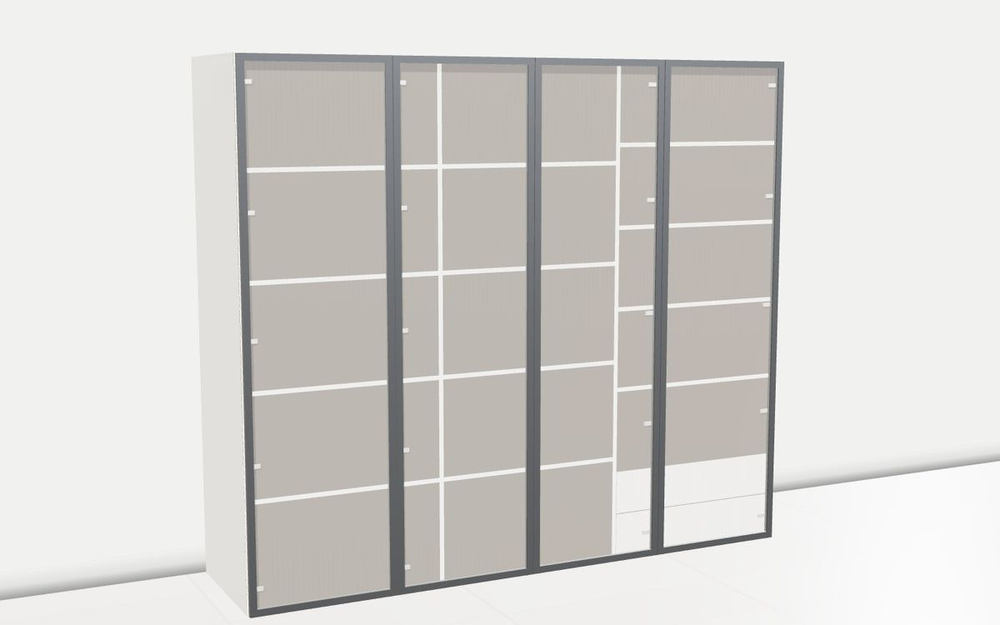
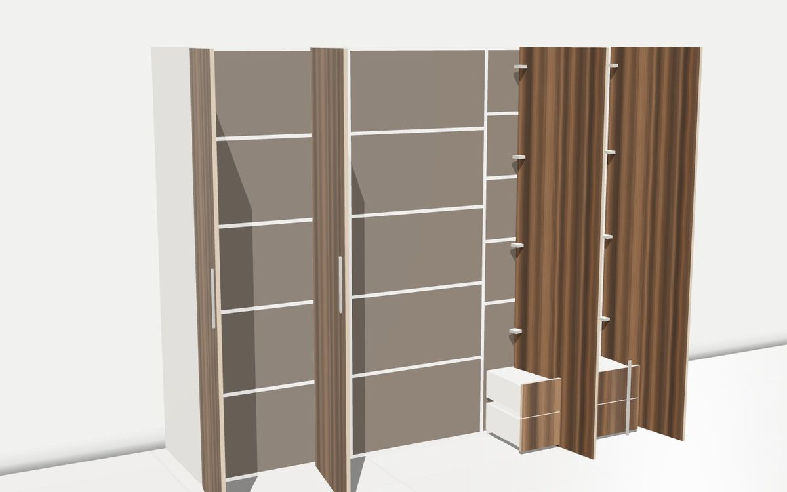
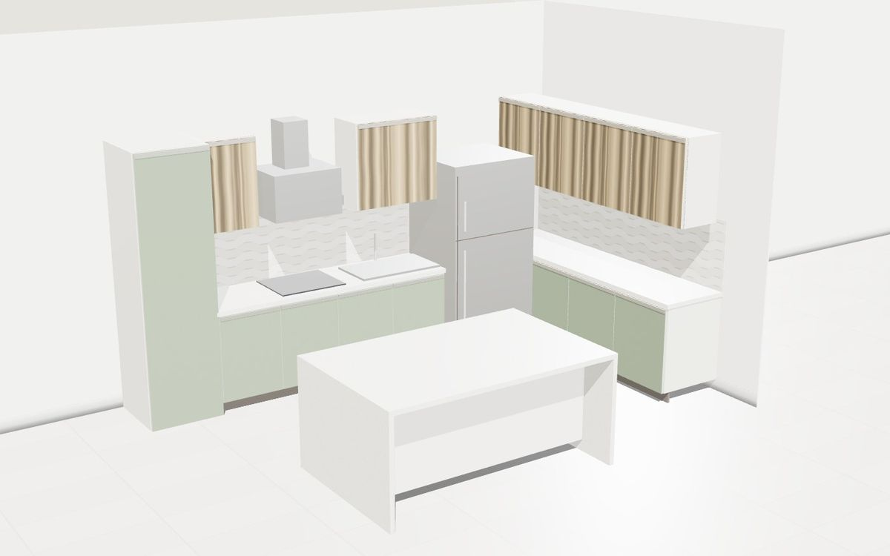
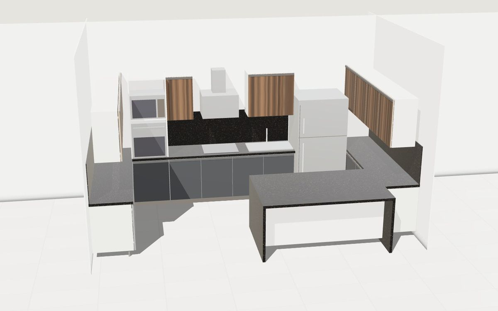
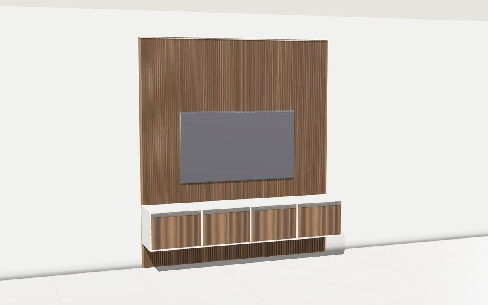
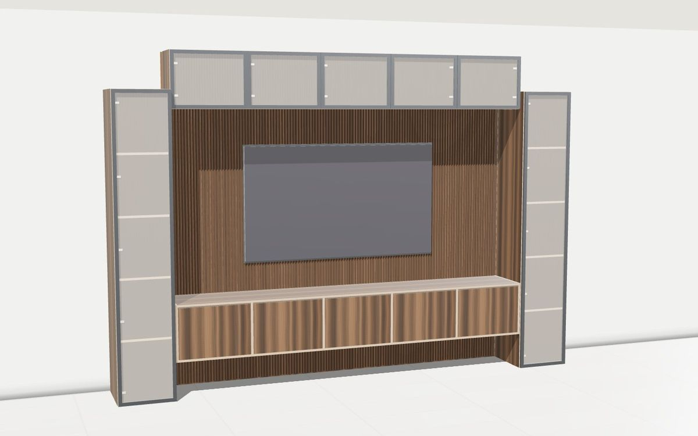
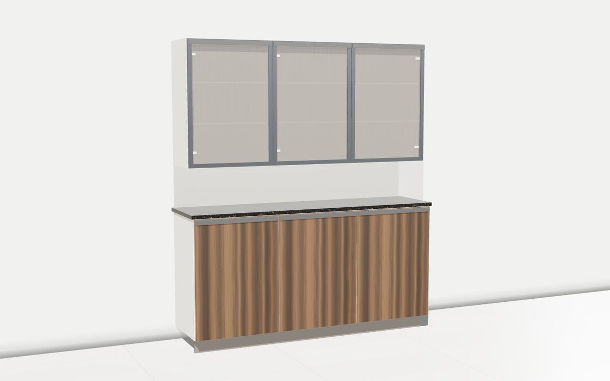
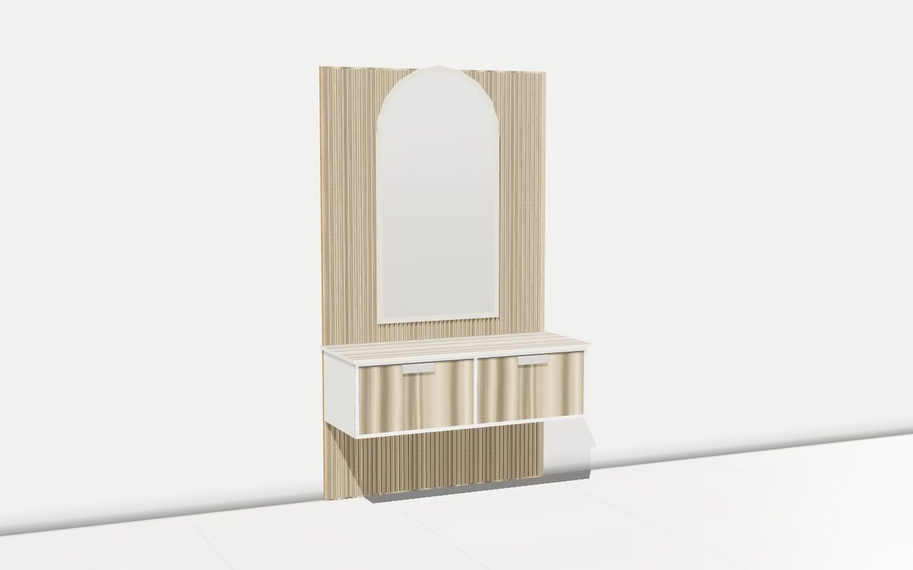

# Cupboard CAD

**Design a cupboard, a kitchen, a TV wall, a crockery unit or a dressing table in 3D and get the factory process sheet, cutting list, sheet nesting, CNC drilling and a quote — in the browser, no install.**

[](https://cupboard-cad-studio.netlify.app)
[](LICENSE)
[](https://github.com/devkancheti4-design/cupboard-cad/stargazers)

If this saves you a day of drawing, **please star the repo** — it is how other designers and factories find it.

| | |
|---|---|
|  |  |
|  |  |
|  |  |
|  |  |

Every image above is rendered by the tool itself.

## What it does

- **Realistic 3D** (three.js): laminate grain, edge banding rendered literally (PVC where the rule bands it, raw core where it doesn't), stone tops, tinted and fluted glass, mirrors, LED, cup hinges, doors and drawers that open and obey physics (a drawer can't open behind a closed shutter).
- **12 unit types**: hinged and sliding wardrobes, loft, kitchen base and wall runs, tall units, TV walls, crockery display units, shoe racks, dressing tables, open shelving, and full modular kitchens (straight, L, U, parallel, island, L + island, peninsula, G-shape).
- **~4,600 catalogue designs** researched from what premium studios sell in 2026 — fluted-glass aluminium profiles, handleless matte colours, two-tone, veneers, gloss acrylic, stone and concrete looks, shaker and raised-panel classics, steel almirahs — with filters per unit type.
- **Factory outputs**: process sheet in the Indian job-work format (S.No / H / W / Qty / Remarks / Design / Colour / SFT / E/B / Rate / Amount, frames, job-work charges, board requirement), elevation drawings with title blocks, System 32 drilling per panel, guillotine sheet nesting on 2440 × 1220 boards with kerf and grain lock, DXF R12 export for CNC (nest + DRILL layer), CSV, print.
- **PDF import**: drop an existing process-sheet PDF (or CSV, or pasted rows); a tolerant parser reads it into an editable review table and the unit is rebuilt in 3D. A report compares the sheet's board order with the optimised nest.
- **Quote**: boards from the nest × ₹/sft per laminate, hardware, job-work and margin — all editable.

No wastage allowance is built into the sheet calculation (boards = ceil(area / 32 sft)); that is a deliberate choice for factories that want the honest number.

## Run it

It is a static site: three files, no build step needed for development.

```bash
git clone https://github.com/devkancheti4-design/cupboard-cad.git
cd cupboard-cad
python3 -m http.server 4180
```

Open http://localhost:4180. Any static server works (`npx serve`, nginx, GitHub Pages, Netlify).

`build.py` inlines `style.css` and `app.js` into `index.html` to produce a single self-contained HTML file:

```bash
python3 build.py cupboard-cad.html
```

## Data

The laminate catalogue in `app.js` (`LAMINATES`) is **demo data**: codes, colours and ₹/sft rates are placeholders. Replace them with your own laminate codes and rates, or add them live from the "Add a laminate" panel in the Design tab (they persist in the browser). Hardware rates (`HARDWARE`), cutting and edge-banding rates (`RATES`) are editable in the Quote tab.

## Project layout

```
index.html   views and markup
style.css    single light theme (colour-critical work, no dark mode by design)
app.js       everything else: data, geometry, WebGL renderer, nesting, drilling, DXF, PDF import, catalogue
build.py     inlines the three files into one HTML
docs/        example renders used in this README
```

Useful hooks in the browser console: `__cc.audit()` builds every catalogue preset and checks that no door renders with a hole; `__cc.gl.snapshot(w,h)` returns a JPEG data-URL of the current scene.

## Contributing

Issues and pull requests are welcome — new door constructions, real laminate libraries, regional process-sheet formats, translations, and CNC post-processors are all good first contributions. Keep the tool unbranded: no company name is hardcoded anywhere, header fields are typed by the user.

## License

[MIT](LICENSE). Use it in your studio, your factory, your product.
